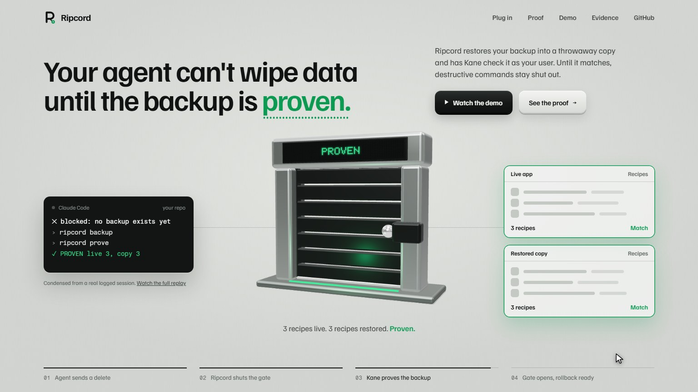
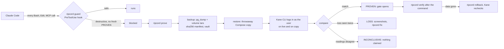

<p align="center"></p>

<h1 align="center">Ripcord</h1>

<p align="center"><b>Your AI agent can't wipe data until the backup is proven.</b><br>
Ripcord restores your backup into a throwaway copy, has <a href="https://www.testmuai.com/kane-cli/">Kane CLI</a> log in to the live app and the copy as your user, and holds every destructive Claude Code command until the two match.</p>

<p align="center">
<a href="https://ripcord-eight.vercel.app"></a>
<a href="https://youtu.be/NRiflN1UKdc"></a>
<a href="https://ripcord-eight.vercel.app/proof.html"></a>


<a href="LICENSE"></a>
</p>

<p align="center"><a href="https://ripcord-eight.vercel.app"></a></p>

## Judges: start here

No sign in, no install. Every link below is a real run, replayed from its log.

| # | Open | What you see | Time |
|---|---|---|---|
| 1 | [Demo video](https://youtu.be/NRiflN1UKdc) | The incident, then three real proofs, then how it plugs in | 3 min |
| 2 | [Gate replay](https://ripcord-eight.vercel.app/replay.html?run=gate) | A real Claude Code session: delete blocked, backup proven by Kane, delete runs, Kane sees 3 recipes become 0, rollback brings 3 back | 1 min |
| 3 | [Fix loop replay](https://ripcord-eight.vercel.app/replay.html?run=fix) | Kane catches a missing photo in the restored copy, Claude Code fixes only `ripcord.yml`, Kane proves it | 1 min |
| 4 | [Evidence](https://ripcord-eight.vercel.app/evidence.html) | Kane's own screenshots: every table restored, photo and attachment still gone (Mealie, Vikunja) | 1 min |
| 5 | [Proof page](https://ripcord-eight.vercel.app/proof.html) | Every study case: backup method, row count verdict, Kane verdict | 2 min |
| 6 | [Raw logs](site/logs/) and [results.json](site/data/results.json) | The unedited session transcript, verify and rollback logs, study data | any |

To run it yourself, see [Quick start](#quick-start) (needs Docker and a Kane CLI login).

## Where Kane does the work

| Step | Kane's job | Code |
|---|---|---|
| Prove | Logs into the live app and the restored copy, runs the same plain English checks, returns assertion results and values | [src/kane.ts](src/kane.ts), [src/fingerprint.ts](src/fingerprint.ts), [src/prove.ts](src/prove.ts) |
| Confirm | Any difference is read again on both sides; a loss counts only when seen twice | [src/prove.ts](src/prove.ts), [src/compare.ts](src/compare.ts) |
| Verify | After a risky command, rereads the live app against the proven state | [src/cli.ts](src/cli.ts) |
| Rollback | Restores the proven backup, then checks the live app again | [src/rollback.ts](src/rollback.ts) |
| Fix loop | Kane's findings go to Claude Code, which may only change `ripcord.yml`, then Kane proves again | [src/cli.ts](src/cli.ts) |

Without Kane, Ripcord could only count rows, and the study shows row counts called two real losses a match.

## Architecture



## Why

In April 2026 a Cursor agent running Claude deleted PocketOS's production database and its volume backups through one Railway API call, in about nine seconds ([TechSpot](https://www.techspot.com/news/112207-ai-coding-agent-running-claude-wiped-startup-database.html), [Tom's Hardware](https://www.tomshardware.com/tech-industry/artificial-intelligence/claude-powered-ai-coding-agent-deletes-entire-company-database-in-9-seconds-backups-zapped-after-cursor-tool-powered-by-anthropics-claude-goes-rogue)). Claude Code's checkpoints only track edits made by its file tools; changes made through bash, which is how agents reach databases, are not tracked ([docs](https://code.claude.com/docs/en/checkpointing)).

And a backup that was never restored is a hope. Tools that do test restores count rows. Rows are not the app: photos, attachments, saved logins and search indexes live elsewhere.

## What it does

```
ripcord prove
  backup   -> pg_dump per database, tar per volume, sha256 manifest, stored in a vault outside the repo
  restore  -> a throwaway copy of your Compose stack on a free port
  Kane     -> logs into the live app and the copy, does the same plain English checks, reads the values back
  compare  -> PROVEN (everything matches), LOSS (exact differences), INCONCLUSIVE (a value could not be read)
  report   -> one HTML page: what Kane read on each side, Kane share links, and what a row count would say
```

- **Gate.** `ripcord hook install` adds Claude Code hooks. A destructive command (DROP, TRUNCATE, DELETE without WHERE, migrate reset, `compose down -v`, volume removal, and more) is held until a PROVEN backup exists for the latest backup. Commands that touch the vault are always blocked.
- **After a risky command.** The agent is told to run `ripcord verify`; Kane rereads the live app against the proven state. If data is gone, `ripcord rollback --yes` restores the proven backup and Kane checks it again.
- **Fix loop.** On LOSS, `ripcord fix` hands Kane's findings to Claude Code, which may only edit `ripcord.yml` (for example to add a missing volume), then proves again, up to three rounds.
- **A loss must be seen twice.** A check where live and copy disagree is read again on both sides. Conflicting readings are INCONCLUSIVE, never PROVEN.

## The study: real apps, real backup methods

Mealie, n8n and Vikunja (current releases, Postgres), each backed up three ways: the app's official method, a common guide, and a script Claude Code wrote from a plain request. Each backup was restored into a fresh copy, then checked two ways: per table row counts, and Kane logging in as the user. Full table with every Kane run: [proof page](https://ripcord-eight.vercel.app/proof.html), data in [site/data/results.json](site/data/results.json).

| App | Method | Row count says | Kane says |
|---|---|---|---|
| Mealie 3.31 | common guide: pg_dump of the database | all 70 tables match | **LOSS**: recipe photo shows on live, not in the copy (API: every photo 404) |
| Vikunja 2.8 | common guide: pg_dump of the database | all 43 tables match | **LOSS**: attachment preview works on live, fails in the copy (API: file does not exist) |
| Vikunja 2.8 | official: `vikunja dump` and `vikunja restore` | rows lost | could not log in: the restore stopped with an error and left 0 users |
| Mealie 3.31 | script written by Claude Code | match | PROVEN |
| Vikunja 2.8 | script written by Claude Code | match | PROVEN |
| Mealie 3.31 | official built in backup | match | INCONCLUSIVE (Kane did not see the photo on live either) |
| n8n 2.49 | official, and CLI export and import | match | INCONCLUSIVE (Kane's live readings disagreed; API shows the CLI copy lost the owner login and its credentials could not be decrypted) |

Two restores kept every row and still lost what users see. Only the check that used the app caught it. When Kane could not decide, Ripcord says INCONCLUSIVE instead of guessing.

## The loops, on real runs

- **Fix loop** ([replay](https://ripcord-eight.vercel.app/replay.html?run=fix)): a ripcord.yml that forgot the photo volume. Kane: photo on live, not in the copy, seen twice: LOSS. Claude Code edited only the backup settings (it added `mealie-data`). Ripcord proved again: PROVEN after 1 fix round.
- **Gate, verify and rollback** ([replay](https://ripcord-eight.vercel.app/replay.html?run=gate), [transcript](site/logs/gate-session.jsonl)): a real Claude Code session was asked to clear out every recipe. The hook blocked `DELETE FROM recipes;` (no backup). Claude ran `ripcord backup` and `ripcord prove` (Kane read 3 recipes on live and copy: PROVEN), then deleted the recipes. `ripcord verify`: Kane saw 3 become 0. `ripcord rollback --yes` saved the current state, restored the proven backup, and Kane counted 3 again: ROLLED BACK.
- **Prove** ([replay](https://ripcord-eight.vercel.app/replay.html?run=prove)): full backup of Mealie, Kane read "photo of food", "6 servings", "3 ingredients" on live and copy: PROVEN, row counts MATCH.

## Quick start

```bash
git clone https://github.com/jenzylove/ripcord && cd ripcord
npm install && npm run build && npm link   # puts `ripcord` on your PATH (the hook calls it)
cd your-compose-project
ripcord init                    # writes ripcord.yml from docker-compose.yml
# edit the checks: what must a user still find after a restore?
export RIPCORD_EMAIL=... RIPCORD_PASSWORD=...
ripcord prove
ripcord hook install            # Claude Code now waits for a proof before destructive commands
```

Needs Docker, Node 20+, and Kane CLI logged in (`npm i -g @testmuai/kane-cli && kane-cli login`).

## What is real and what is not

| Part | Status |
|---|---|
| Backup, copy restore, row counts | real, tested on live Mealie (70 tables, 0 mismatches) |
| Kane fingerprint and compare | real Kane runs, share links in the reports |
| Claude Code gate | real hook; tested with Claude Code's hook input; 58 classifier tests |
| Fix loop | real run: LOSS, Claude Code fix, PROVEN (replay linked above) |
| Verify and rollback | real runs: 3 recipes to 0 caught by Kane, rollback brought back 3 (replay linked above) |

## Limits

- The vault is on the same machine. The hook blocks agent commands that touch it, but anything running with your user rights can still delete it. Copy it off the machine.
- Kane checks what you describe, not every record. Each check costs Kane credits (about 20 to 30 per check per side in our runs; a two check proof costs roughly 90 to 130) and one to two minutes; runs go one at a time because parallel Kane runs on one machine contaminate each other.
- No hover based checks (Kane has no hover).

## Tests

`npm test` runs 134 tests: compose parsing, config validation, value comparison, the destructive command classifier, state, Kane output parsing on real Kane runs, and the Docker engine helpers.

## License

MIT
